# OpenBook e-Reader

Hardware design of **OpenBook**, a low-power, open-source e-book reader built around the
**ESP32-C6** (Wi-Fi 6 + Bluetooth LE, RISC-V). The repository contains the complete design
package: schematic and 2-layer PCB, manufacturing outputs (Gerbers, BOM, pick-and-place) and the
3D mechanical assembly of the device (enclosure, e-paper display, Li-Po battery and PCB).

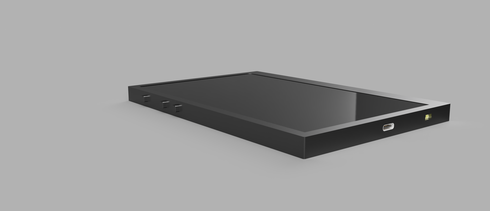

## Highlights

- **ESP32-C6-WROOM-1-N8** module with the antenna at the board edge and a copper keep-out
  (board cut-out) under it for RF performance.
- **E-paper display** driven over SPI through a 24-pin FPC connector, with the panel's booster
  circuit on board.
- **64 MB external NOR Flash** (W25Q512JV) for books, fonts and images, plus a **microSD** socket.
- **Li-Po power system**: USB-C charging (MCP73831), battery fuel gauge (MAX17048), 3.3 V LDO,
  ESD and overvoltage protection.
- **DS3231 RTC** with supercapacitor backup, able to wake the MCU from deep sleep.
- **BME688 environmental sensor** and a **Qwiic / STEMMA QT** connector for I2C expansion.
- **Single-sided assembly**: all components on the top layer, mostly 0402 SMD, clearly labelled
  test pads for SPI, I2C, UART and power rails.
- Full **3D integration** in Fusion 360 to check fit and clearances between PCB, display,
  battery and enclosure before prototyping.

## Board specifications

| Parameter | Value |
|-----------|-------|
| Layers | 2 (solid ground pour with via stitching) |
| Board outline | 170.2 mm x 111.2 mm |
| Board thickness | 1.67 mm |
| Component placement | Top layer only |
| Trace width | 0.3 mm power, 0.15 mm minimum for signals |
| Supply | 3.3 V from LDO, Li-Po battery charged over USB-C |

## Block diagram


## Key components

The full, EDA-exported bill of materials is in
[`Manufacturing/Bill_of_Materials.csv`](Manufacturing/Bill_of_Materials.csv).

| Ref | Part | Function | Datasheet |
|-----|------|----------|-----------|
| U2 | ESP32-C6-WROOM-1-N8 | Main MCU module (RISC-V, up to 160 MHz, 8 MB flash, Wi-Fi 6, BLE 5) | [PDF](https://www.snapeda.com/parts/ESP32-C6-WROOM-1-N8/Espressif%20Systems/datasheet/) |
| U1 | Winbond W25Q512JVEIQ | 512 Mbit (64 MB) SPI NOR Flash | [PDF](https://www.snapeda.com/parts/W25Q512JVEIQ/Winbond%20Electronics/datasheet/) |
| U3 | Analog Devices DS3231SN# | Temperature-compensated I2C RTC | [PDF](https://www.snapeda.com/parts/DS3231SN%23/Analog%20Devices/datasheet/) |
| C10_SUPERCAP | Seiko CPH3225A | 11 mF supercapacitor (RTC backup) | [PDF](https://mm.digikey.com/Volume0/opasdata/d220001/medias/docus/6537/rev05-CPHCPM.pdf) |
| U4 | Analog Devices MAX17048G+T10 | Li-Po fuel gauge | [PDF](https://www.snapeda.com/parts/MAX17048G+T10/Analog%20Devices/datasheet/) |
| U5 | Microchip MCP73831 | Single-cell Li-Po charge controller | [PDF](https://datasheet.datasheetarchive.com/originals/distributors/Datasheets-DGA15/727147.pdf) |
| IC4 | Torex XC6220A331MR-G | 3.3 V LDO regulator | [PDF](https://product.torexsemi.com/system/files/series/xc6220.pdf) |
| IC1 | ROHM BD5229G-TR | Voltage detector with adjustable delay (reset) | [PDF](https://datasheet.datasheetarchive.com/originals/distributors/Datasheets_SAMA/f2b9741ef86007909f138d561a359946.pdf) |
| SENSOR2 | Bosch BME688 | Temperature, pressure, humidity and VOC sensor | [PDF](https://www.snapeda.com/parts/BME680/Bosch%20Sensortec/datasheet/) |
| J1 | Hirose FH34SRJ-24S-0.5SH(99) | 24-pin 0.5 mm FPC connector for the e-paper panel | [PDF](https://www.hirose.com/en/product/document?clcode=CL0580-1255-6-99&productname=FH34SRJ-24S-0.5SH(99)&series=FH34SRJ&documenttype=2DDrawing&lang=en&documentid=0000990903) |
| L1, D3-D5, Q3 | Wurth 744043680, MBR0530, Si1308EDL | E-paper booster circuit (68 uH inductor, Schottky diodes, N-MOSFET) | [L1](https://download.siliconexpert.com/pdfs/2018/1/3/16/30/56/604/weg_/manual/401950550574837744043680.pdf), [D](https://www.onsemi.com/pdf/datasheet/mbr0530-d.pdf), [Q3](https://componentsearchengine.com/Datasheets/1/SI1308EDL-T1-GE3.pdf) |
| J2 | GCT USB4110-GF-A | USB 2.0 Type-C receptacle | [PDF](https://gct.co/files/drawings/usb4110.pdf) |
| D1 | ST USBLC6-2SC6Y | USB ESD protection | [PDF](https://componentsearchengine.com/Datasheets/1/USBLC6-2SC6Y.pdf) |
| PFMF.050.1 | TDK B72520T0350K062 | Varistor (overvoltage protection) | [PDF](https://datasheet.datasheetarchive.com/originals/distributors/Datasheets_SAMA/81dc50a8c35dfdf39bcf4cbe36cdf37d.pdf) |
| D6, D8-D12 | Littelfuse PGB1010603MR | ESD suppressors | [PDF](https://www.snapeda.com/parts/PGB1010603MR/Littelfuse%20Inc./datasheet/) |
| Q1, Q2 | Diodes DMG2305UX-7 | P-channel MOSFETs | [PDF](https://www.diodes.com/assets/Datasheets/DMG2305UX.pdf) |
| J3 | JST SM04B-SRSS-TB | Qwiic / STEMMA QT I2C connector | [PDF](https://www.snapeda.com/parts/SM04B-SRSS-TB(LF)(SN)/JST%20Sales/datasheet/) |
| J4 | Attend 112A-TAAR-R03 | microSD card socket (push-push) | [PDF](https://www.attend.com.tw/data/download/file/112A-TAAR-R03.pdf) |
| RESET / BOOT / CHANGE | Panasonic EVQPUJ02K | Side-actuated tactile buttons | [PDF](https://www.alldatasheet.com/datasheet-pdf/view/537835/PANASONIC/EVQPUJ02K.html) |
| CHG_LED | Kingbright KP-1608SURCK | Charge status LED | [PDF](https://www.snapeda.com/parts/KP-1608SURCK/Kingbright/datasheet/) |

## How it works

### Interfaces

| Peripheral | Bus | Signals |
|------------|-----|---------|
| E-paper display | SPI | MOSI, MISO, SCK, CS, DC, BUSY, RST |
| External NOR Flash | SPI (shared with the display) | MOSI, MISO, SCK, CS |
| RTC (DS3231) | I2C | SDA, SCL |
| BME688 sensor | I2C | SDA, SCL |
| Qwiic expansion port | I2C | SDA, SCL |
| Charge controller | USB | VBUS, GND, STAT LED |

### ESP32-C6 pin assignment

| Peripheral | ESP32-C6 pin | Function | Rationale |
|------------|--------------|----------|-----------|
| E-paper display | IO4 / IO5 / IO6 | MOSI / MISO / SCK | Fast SPI transfers for screen updates |
| | IO7 | Chip select | Separates the display from the Flash on the shared bus |
| | IO8 | Data/Command (DC) | Switches between data and command mode |
| | IO9 | Reset (RST) | Hardware reset for display initialisation |
| | IO10 | BUSY | Lets the MCU poll the panel state without blocking |
| External Flash | IO4 / IO5 / IO6 | MOSI / MISO / SCK | Shares the SPI bus with the display to save pins |
| | IO11 | Chip select | Dedicated CS for the Flash |
| RTC + BME688 | IO18 / IO19 | SDA / SCL | Shared I2C bus; the two devices have different addresses |
| Reset button | EN | Reset | Native ESP32 hardware reset |
| Boot button | IO0 | Boot | Enters download mode for flashing firmware |
| Charge status | IO13 | GPIO | Visual indication of the charging state |
| Debug UART (test pads) | IO16 / IO17 | TXD0 / RXD0 | Debugging without extra connectors |

### Power management

- The e-paper panel only draws power while the image is refreshed.
- The ESP32-C6 spends idle time in deep sleep; the RTC can wake it at programmed intervals.
- A low-ripple 3.3 V LDO supplies the system, with 100 nF decoupling placed close to every IC
  supply pin.

Estimated current consumption (design estimates, not measurements):

| State | Estimated current |
|-------|-------------------|
| Wi-Fi active + e-paper update | ~180-250 mA |
| Standby with RTC running | ~10-20 uA |
| Deep sleep | ~2.5 uA |

## Design process

The design started from a set of requirements given by the system architect (routing rules,
dimensions, component placement and EMC guidelines). Priorities were a compact PCB without
compromising RF performance, clean and stable power for every module, and extensibility through
the Qwiic connector.

1. **Schematic** (Fusion Electronics): all required blocks (ESP32-C6, RTC, BME688, charger, NOR
   Flash, e-paper), ESD protection on sensitive lines and decoupling on every supply.
2. **PCB layout**: top-side placement only, antenna at the board edge with no copper under it,
   ground pours with dense via stitching around the ESP32, short SPI traces to the display
   connector, test pads labelled on the silkscreen.
3. **Design review**: manual check of critical power and communication traces, plus DRC and ERC.
4. **Manufacturing outputs**: Gerber files, BOM and pick-and-place file.
5. **3D integration**: 3D models of the e-paper display and Li-Po battery were created and the
   PCB was fitted into the existing enclosure, checking display centring, USB-C access, a clear
   antenna area and collisions between PCB, display and housing.

### Problems solved

- **Crowding around the ESP32-C6**: components were rearranged to avoid vias on critical power
  traces while keeping high-speed signals short.
- **Ground pour overlapping the antenna area**: the pour outline was adjusted so the area under
  the antenna is completely free of copper.
- **Clearance in dense areas** (e.g. the e-paper connector): a reduced minimum clearance was
  accepted where modern fabrication tolerances allow it, and verified with DRC.
- **Long SPI traces to the display**: the display connector and its passives were placed as close
  to the ESP32 as the layout allowed.

### Revision history

- Initial: functional placement without mechanical optimisation.
- Rev 1: power routing optimised to avoid vias on power lines.
- Rev 2: ESP32 antenna layout improved, all copper removed under the antenna.
- Rev 3: clearance checks and test pad markings added.
- Final: 3D integration and full assembly check.

### Possible improvements

- Additional internal connectors for hardware extensions (e.g. audio).
- A more robust mechanical retention for the battery.
- Ferrite beads on critical supply lines for further EMC improvement.

## Gallery

| | |
|---|---|
| 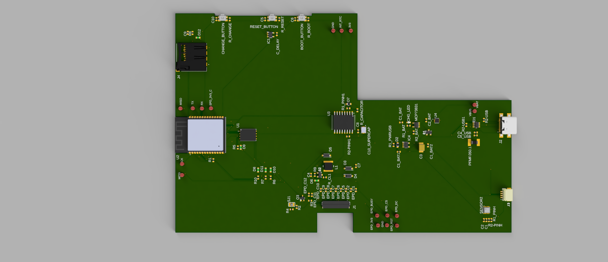 | 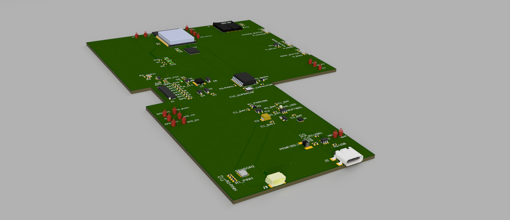 |
| PCB, top view | PCB, 3D view |
| 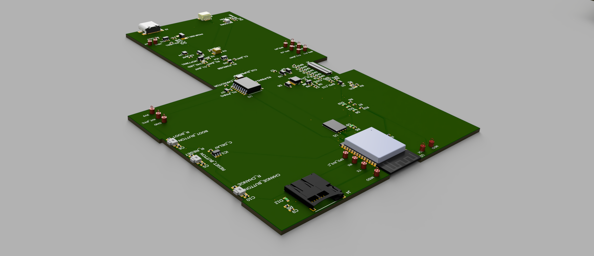 | 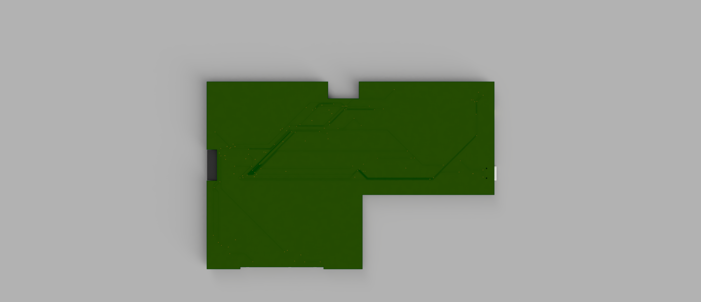 |
| PCB, 3D view from the opposite corner | PCB, bottom view (ground pour) |
| 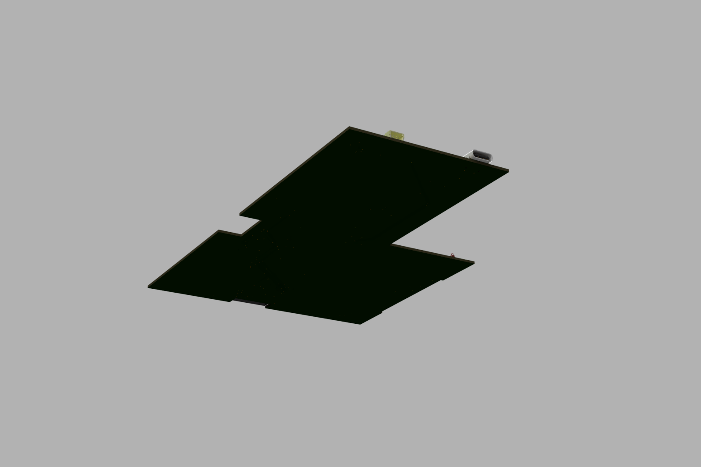 | 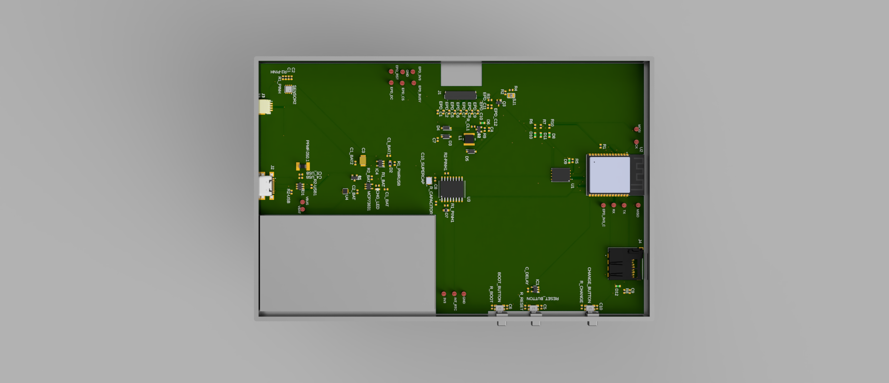 |
| PCB bottom, 3D view | PCB fitted inside the enclosure |
| 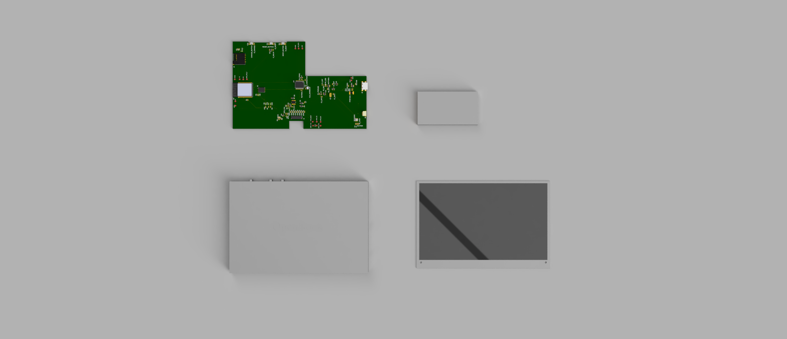 | 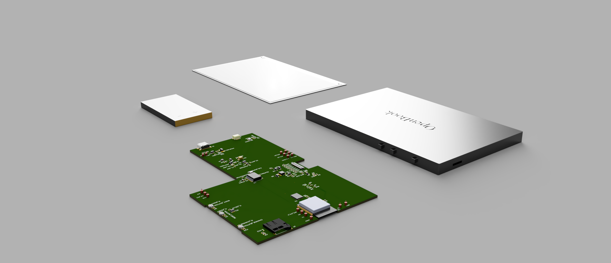 |
| Exploded view (top) | Exploded view (3D) |
| 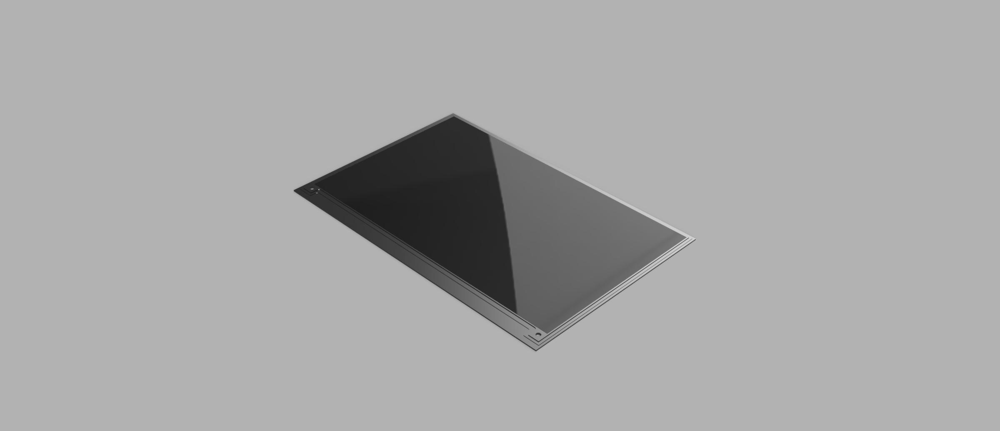 | 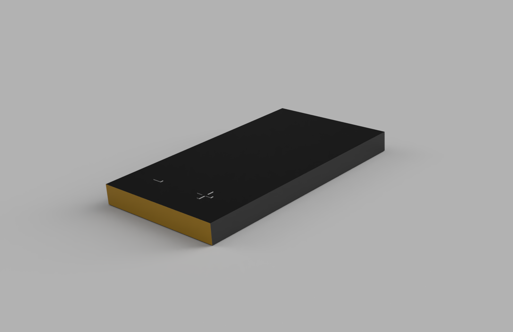 |
| E-paper display model | Li-Po battery model |
|  | 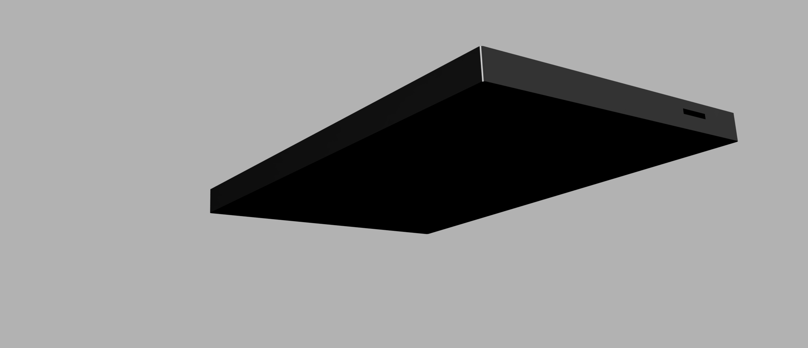 |
| Assembled device, front | Assembled device, back |

## Tools

- **Autodesk Fusion Electronics 9.7** (EAGLE-format `.sch` / `.brd`) for schematic and PCB layout
- **Autodesk Fusion 360** for the mechanical design and 3D assembly (`.f3z`, STEP export)

## Opening the design

- **Schematic / PCB**: open `Hardware/OpenBook_Schematic.sch` and `Hardware/OpenBook_PCB_vf.brd`
  in Fusion Electronics or EAGLE 9.x (KiCad can also import EAGLE files).
- **Fabrication**: `Manufacturing/gerbers.zip` contains the Gerber set (copper, solder mask, paste,
  silkscreen, board profile and a Gerber job file) ready to upload to a PCB fab.
- **Assembly**: `Manufacturing/Bill_of_Materials.csv` and `Manufacturing/Pick_and_Place.csv`
  (centroid coordinates in mm).
- **Mechanical**: `Mechanical/EBook_3D_vf.f3z` opens in Fusion 360; `Mechanical/Exploded_EBook_vf.step.zip`
  contains a STEP model of the exploded assembly for any CAD tool.

This repository covers the hardware only; no firmware is included.

## Project structure

```
.
├── Hardware/
│   ├── OpenBook_Schematic.sch      # Schematic (Fusion Electronics / EAGLE)
│   └── OpenBook_PCB_vf.brd         # Final PCB layout
├── Manufacturing/
│   ├── Bill_of_Materials.csv       # BOM exported from the EDA tool
│   ├── Pick_and_Place.csv          # Component placement (centroid) file
│   └── gerbers.zip                 # Gerber files for fabrication
├── Mechanical/
│   ├── EBook_3D_vf.f3z             # Fusion 360 assembly (enclosure, PCB, display, battery)
│   └── Exploded_EBook_vf.step.zip  # STEP model of the exploded assembly
├── Images/                         # Renders of the PCB and the assembled device
└── LICENSE
```

## License

Licensed under the [Apache License 2.0](LICENSE).

## Author

George-Armand Ursei - [GitHub](https://github.com/armandursei)
